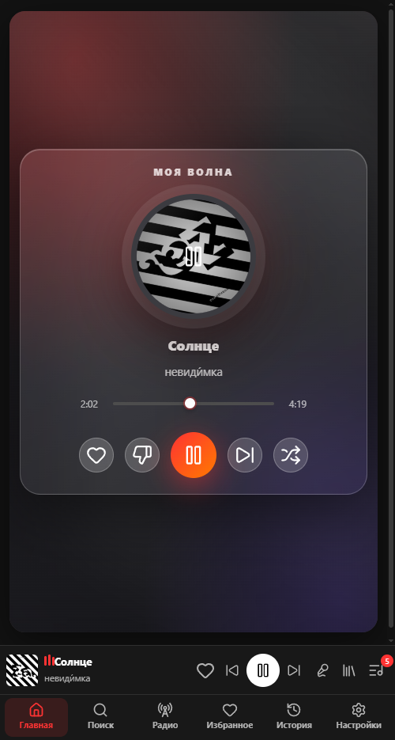
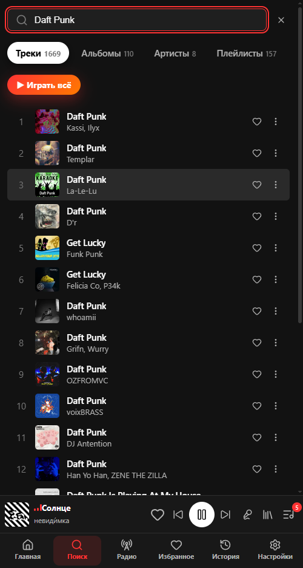
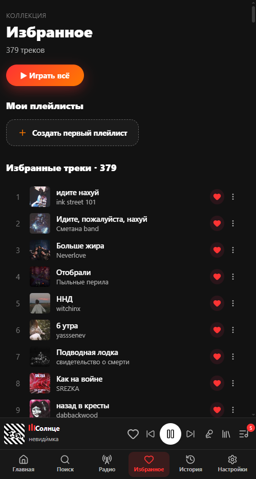
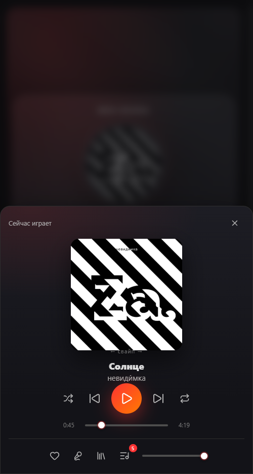

# 🎵 Muse — музыкальный плеер

Неофициальный клиент Яндекс Музыки. **Один код → три платформы**: веб, Windows (`.exe`), Android (`.apk`).

[](https://github.com/savamessage-alt/Muse)


---

## ✨ Возможности

- 🔐 **Вход через аккаунт** (OAuth Device Flow): код на экране → подтверждение на ya.ru/device. Ручной ввод токена — запасной путь.
- 🔄 **Автообновление токена** по `refresh_token`; при истечении/отзыве — повторный вход.
- 🔍 Поиск (треки / альбомы / артисты / плейлисты), лента, новинки, чарты.
- 📂 Плейлисты: просмотр, создание, редактирование.
- ❤️ Лайки «Мне нравится», история прослушивания.
- 💿 Альбомы, артисты (популярные треки, дискография).
- 📻 Радио: «Моя волна» и станции с обратной связью (лайк / скип).
- 🎧 Очередь, повтор, перемешивание, перемотка, громкость, Media Session (системные клавиши).
- 🎚 Выбор качества: MP3 320 / 192 / 128.
- 🌙 Тёмная тема, полностью русский интерфейс.
- 📱 **Android**: фоновое воспроизведение через foreground-сервис, медиа-виджет (MediaStyle) с лайком и seekbar.
- 🖥 **Windows**: нативный `.exe` через Electron + electron-builder.
- 🔄 Синхронизация Ynison (управление с других устройств).

## 📸 Скриншоты

| Главная | Поиск |
|---|---|
|  |  |

| Избранное | Плеер |
|---|---|
|  |  |

## 🚀 Быстрый старт (веб)

```bash
npm install
npm run dev          # http://localhost:5173
```

Откройте адрес, нажмите «Войти в аккаунт», введите показанный код на ya.ru/device — и слушайте музыку.

## 🏗 Сборка приложений

### Проверка типов и сборка веба

```bash
npx tsc -b --pretty false   # 0 ошибок
npm run build               # → dist/
```

### Windows `.exe`

```bash
npm run electron:build      # → release/Muse Setup *.exe
npm run electron:dev        # запуск Electron в dev-режиме
```

### Android `.apk`

Требуется **JDK 21** (Java 25 ломает Gradle 8.13) и Android SDK.

```bash
npm run cap:sync            # собрать веб + синхронизировать в нативное приложение
npm run cap:open:android    # открыть в Android Studio → Run
# или из консоли:
$env:JAVA_HOME = "C:\Program Files\Eclipse Adoptium\jdk-21.0.11.10-hotspot"
cd android
.\gradlew.bat assembleRelease   # → app/build/outputs/apk/release/app-release.apk
```

Установка на устройство:

```bash
adb install -r android\app\build\outputs\apk\release\app-release.apk
```

## 📁 Структура проекта

```
src/
  core/        # транспорт, OAuth, токен-менеджер, REST-клиент, плеер, стриминг, Ynison, подписи
  state/       # глобальное состояние (zustand)
  components/  # страницы и компоненты UI
electron/      # main-процесс и preload (Windows)
docs/          # api-notes, auth-notes, ynison-protocol, roadmap, скриншоты
CHECKLIST.md   # чек-лист функций и релиза
AGENTS.md      # инструкции для ИИ-агентов
```

## 📱 Платформы

| Платформа | Технология | Статус |
|---|---|---|
| Веб | React 19 + Vite 8 + TypeScript | ✅ работает |
| Windows (`.exe`) | Electron 38 + electron-builder | ✅ собирается |
| Android (`.apk`) | Capacitor 8 + foreground-сервис | ✅ установлено и работает |

## ⚠️ Предупреждение

Проект неофициальный, API Яндекса не документировано и может меняться. Без подписки Яндекс Плюс часть треков недоступна (30-секундные превью). Неофициальность означает: возможны изменения без предупреждения.

Основано на обратном инжиниринге API из проекта [MarshalX/yandex-music-api](https://github.com/MarshalX/yandex-music-api) (OpenAPI-спека, документация [ym.marshal.dev](https://ym.marshal.dev/)). Подробности — в [docs/](docs/) и [CHECKLIST.md](CHECKLIST.md).

Лицензия кода-основы: LGPL-3.0 (MarshalX/yandex-music-api).

## 🤝 Вклад

См. [CONTRIBUTING.md](CONTRIBUTING.md). Перед коммитом — `npx tsc -b --pretty false` → 0 ошибок. Секреты (`android/keystore.properties`, токены) не коммитить.